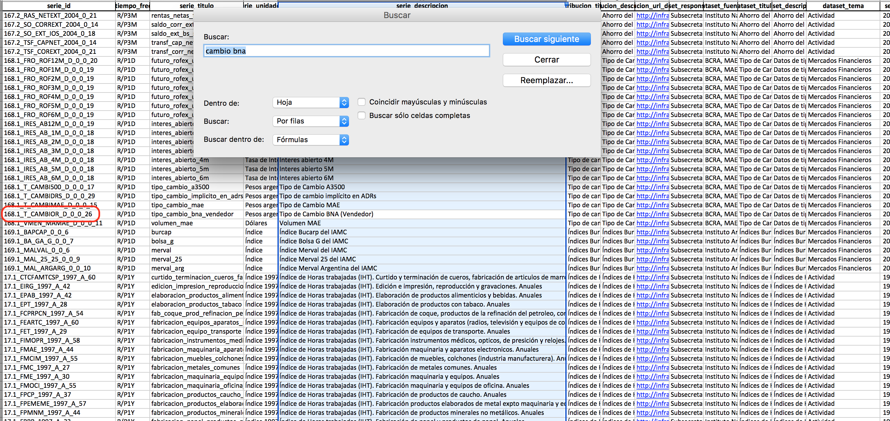
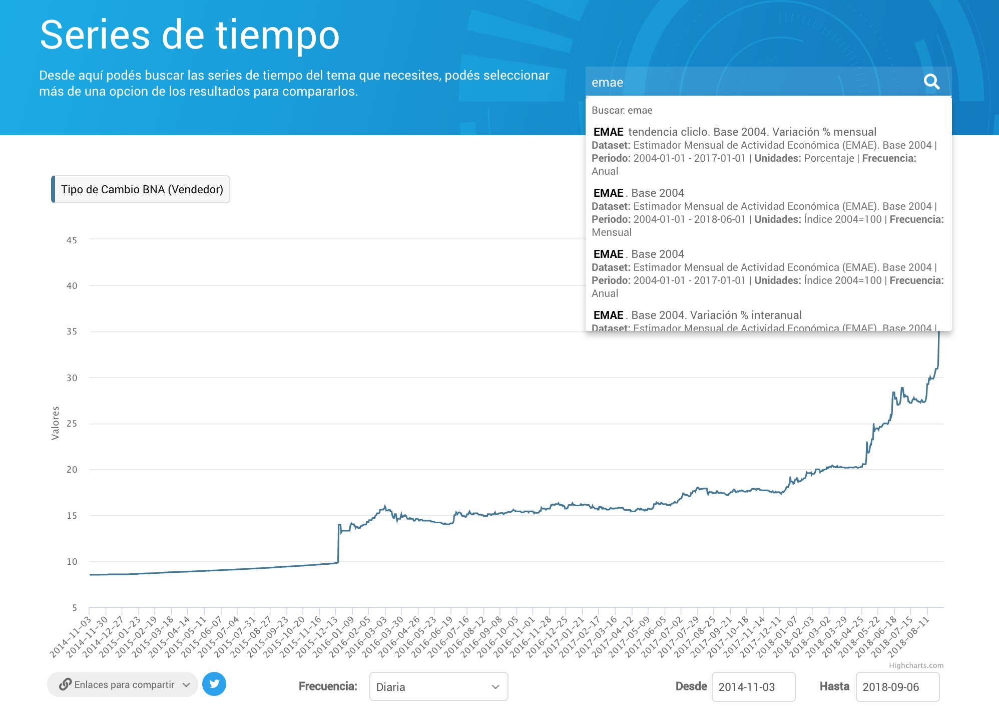
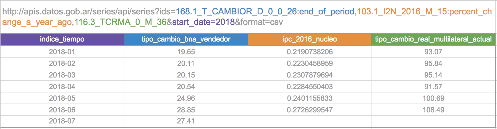
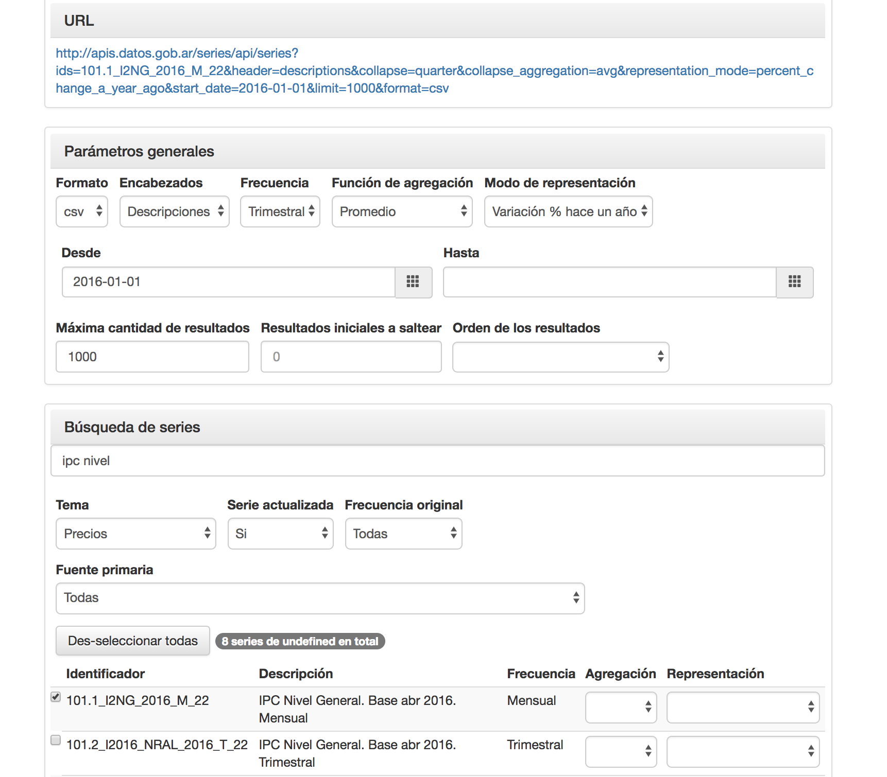

## 1. Buscar series

Para usar la API, tenés que buscar los _ids_ de las series que te interesan.

### En un archivo

En [datos.gob.ar](http://datos.gob.ar) podés encontrar la [base completa de series de tiempo](http://datos.gob.ar/dataset/modernizacion-base-series-tiempo-administracion-publica-nacional), que contiene la lista de series disponibles en:

+ [CSV](http://infra.datos.gob.ar/catalog/modernizacion/dataset/1/distribution/1.2/download/series-tiempo-metadatos.csv)
+ [XLSX](http://infra.datos.gob.ar/catalog/modernizacion/dataset/1/distribution/1.6/download/series-tiempo-metadatos.xlsx)
+ [DTA](http://infra.datos.gob.ar/catalog/modernizacion/dataset/1/distribution/1.10/download/series-tiempo-metadatos.dta)

  

### En el explorador de series

En el [Explorador de Series de Tiempo](http://datos.gob.ar/series) podés buscar series, visualizarlas y compartir las URLs a la API o al explorador.

## 2. Armar consulta

### Manualmente

Los ids de las series deben pasarse al parámetro `ids`. Se pueden usar parámetros adicionales para [filtrar y transformar las series](/series-tiempo-ar-api/additional-parameters/).

Ver la [referencia API](/series-tiempo-ar-api/reference/api-reference/) para consultar la documentación completa de todos los parámetros disponibles.

### En el generador de consultas

En el [generador de consultas](https://datosgobar.github.io/series-tiempo-ar-call-generator) podés ver todos los parámetros disponibles en la API para armar tu consulta.

## 3. Realizar consulta

### Consultar o integrar JSON

Para realizar la consulta directamente en el navegador, o integrarla en una aplicación:

* Usar `format=json` (valor default).
* Elegir el nivel de detalle de los metadatos `metadata=none`, `only`, `simple` o `full`.

[`https://apis.datos.gob.ar/series/api/series?ids=168.1_T_CAMBIOR_D_0_0_26,103.1_I2N_2016_M_15&format=json&metadata=full`](https://apis.datos.gob.ar/series/api/series?ids=168.1_T_CAMBIOR_D_0_0_26,103.1_I2N_2016_M_15&format=json&metadata=full)

### Descargar CSV

Para descargar un archivo CSV:

* Usar `format=csv`.

[`https://apis.datos.gob.ar/series/api/series?ids=168.1_T_CAMBIOR_D_0_0_26,103.1_I2N_2016_M_15&format=csv`](https://apis.datos.gob.ar/series/api/series?ids=168.1_T_CAMBIOR_D_0_0_26,103.1_I2N_2016_M_15)

### Integrar en planilla de cálculo

Tanto la consulta en CSV como en JSON se pueden [integrar en planillas de cálculo](/series-tiempo-ar-api/spreadsheet-integration/).

### Consultar en el explorador de series

Cualquier llamada a la API se puede visualizar en el explorador quitando el subdominio `apis` de la URL (y cambiando a HTTP):

**Llamada a la API**

[`https://apis.datos.gob.ar/series/api/series?ids=168.1_T_CAMBIOR_D_0_0_26:percent_change_a_year_ago&collapse=month`](https://apis.datos.gob.ar/series/api/series?ids=168.1_T_CAMBIOR_D_0_0_26:percent_change_a_year_ago&collapse=month)

**Consulta en el explorador**

[`http://datos.gob.ar/series/api/series?ids=168.1_T_CAMBIOR_D_0_0_26:percent_change_a_year_ago&collapse=month`](http://datos.gob.ar/series/api/series?ids=168.1_T_CAMBIOR_D_0_0_26:percent_change_a_year_ago&collapse=month)
